# PlacementRadar
### Job Intelligence and Outreach Automation for College Placement Cells
#### Semester III Mini Project, Final Report

**Student:** Shubham Chavan
**Roll No:** 17030925005
**Institution:** K. J. Somaiya Institute of Management
**Submission:** Final report, 25th October 2026
**Live Application:** https://placementradar.onrender.com
**Repository:** https://github.com/shubechavan/placementradar

---

## Abstract

PlacementRadar automates the outreach work of a college placement committee. It searches 23 job boards for openings, works out each hiring company's real website, finds and verifies HR emails and phone numbers, scores each contact by reliability, and gives the committee a shared CRM to manage outreach. The contact store grew from 314 companies and 501 contacts at the first draft to 1,732 companies and 2,324 contacts at the final submission, and 97.5% of the emails pass a live mail-server check. The system costs nothing a month to run.

## 1. Introduction

Campus placement work is a sales funnel run by student volunteers. A committee has to find hiring companies, find someone to contact at each, reach out, follow up and keep a shared record. Most of this is done by hand, in spreadsheets, by students who also have coursework.

This project treats that funnel as an engineering problem. The main thing it taught me is that collecting contact data is easy and verifying it is hard. A contact list that is 80% correct is worth much less than 80% of a correct one, because nobody can tell which 80% is right.

The project had three milestones. The first draft (25th September 2026) covered the core pipeline, the second draft (18th October 2026) covered scaling up and repairs, and this report covers the finished system and the rebuilt user interface.

## 2. Problem statement

The placement workflow breaks down in five places.

- Job openings are spread across Naukri, Internshala, LinkedIn, Indeed, Foundit, Shine, Apna and many startup boards, and no single portal covers them all.
- Listings rarely include a recruiter's email or phone. Finding one takes about five minutes per company, so 300 companies take 25 hours before the first email goes out.
- Contact data goes stale and is often filed under the wrong company. In this project's own data, 23.5% of contacts were attached to the wrong employer, and summary counts give no sign of it.
- Without a shared record, two members call the same company in the same week, follow-ups lapse, and the history leaves with each year's committee.
- A pipeline that throws away good data without saying so does more harm than one that fails loudly, because the committee cannot ask for contacts it never knew existed.

### Objectives

1. Collect job openings from many portals into one deduplicated store.
2. Find HR contact details for each company automatically.
3. Verify each contact: that it is deliverable, valid, and belongs to the right employer.
4. Score contacts so the committee spends its time on the most reliable ones.
5. Give the committee a shared CRM with ownership, activity history and a pipeline board.
6. Run at zero infrastructure cost.
7. Measure the quality of the system's own output and report it honestly, failures included.

## 3. System architecture

```
  ┌────────────┐  ┌────────────┐  ┌──────────────┐  ┌──────────────┐
  │ Job Boards │  │  Company   │  │ HR Contact   │  │ OpenStreetMap│
  │   (20+)    │  │  Websites  │  │ Directory    │  │  + Wikidata  │
  └─────┬──────┘  └─────┬──────┘  └──────┬───────┘  └──────┬───────┘
        └───────────────┴────────┬───────┴─────────────────┘
                                 ▼
                    ┌─────────────────────────┐
                    │     SCRAPING ENGINE     │  response guards,
                    │                         │  per-source metrics
                    └────────────┬────────────┘
                                 ▼
                    ┌─────────────────────────┐      ┌──────────────────┐
                    │   IDENTITY RESOLUTION   │◄────►│ HUMAN REVIEW     │
                    │ company → confirmed site│      │ QUEUE            │
                    └────────────┬────────────┘      └──────────────────┘
                                 ▼
                    ┌─────────────────────────┐
                    │ ENRICHMENT + VERIFY     │  sitemap crawl, MX lookup,
                    │                         │  mobile + landline checks
                    └────────────┬────────────┘
                                 ▼
                    ┌─────────────────────────┐
                    │   CONFIDENCE SCORING    │  0-1 score, A-F grade
                    └────────────┬────────────┘
                                 ▼
          ┌──────────────────────┴───────────────────────┐
          ▼                                              ▼
  ┌───────────────┐                         ┌──────────────────────────┐
  │   MongoDB     │◄───────────────────────►│  Flask API + React app   │
  │ company store │                         │  Today · Job board ·     │
  │ + auth store  │                         │  Pipeline · Outreach     │
  └───────────────┘                         └──────────────────────────┘
```

All four sources feed the same pipeline. Identity resolution sits at its centre. When the evidence cannot show which company a website or contact belongs to, the case goes to a human review queue. Heavy scraping runs on GitHub Actions so the web server stays light, and MongoDB holds the shared data and passes results between the two.

## 4. Methodology

Every company goes through the same five stages, whichever source it came from.

1. Scrape. Sources run in parallel within a time budget. Each response passes a response guard (a redirect check plus a relevance score) that confirms the page answers the query. Per-source metrics record whether a source was blocked or simply found nothing.
2. Identity resolution. A name alone cannot identify a company: in this data, "Genesis" refers to three different firms. Each company is matched to a website, and the match is accepted only when the page itself names the company in its title, site name or footer. If the first guess fails, the resolver tries other domain suffixes, a short-name domain and Wikidata's official-website record. Records are keyed `domain:<site>` once confirmed and `key:<name>` until then.
3. Enrichment. For confirmed companies the system crawls the sitemap, visits contact, about, careers and team pages first, and records the page each email or phone came from.
4. Verification. Emails get a syntax check and a live DNS mail-server (MX) lookup. Phone numbers go through Google's libphonenumber, which accepts office landlines as well as mobiles. An attribution check compares each contact's domain with the company's confirmed domain.
5. Scoring and storage. Contacts are scored from independent evidence and stored append-only, so a new scrape can only add to the store. Contacts that fail attribution are quarantined and can be restored if the rejection turns out to be wrong.

Any of the five stages can send an unclear case to the review queue. `advice@rethink.org` and `rethink.com`, for example, look alike but belong to different organisations, and only a person looking at the evidence can tell them apart.

## 5. Implementation

The system works end to end: scraping, verification, storage, a team CRM and a rebuilt interface, all on a Flask API over MongoDB.

### 5.1 Modules

| Module | What it does |
|---|---|
| Job scraper | 20+ portals in parallel, location-aware URLs, response guards against redirects and off-topic pages |
| Identity resolution | Matches each company to its confirmed website through a corroboration gate, with suffix, short-name and Wikidata fallbacks |
| Contact finder | Sitemap crawl of contact pages; emails and phones with the page they came from |
| Verification | MX lookup for emails; libphonenumber for mobiles and office landlines; parked-domain screening |
| Scoring | Own-domain match, MX, named person, HR role and cross-company spread combined into a score from 0 to 1 |
| HR directory import | 1,838-row company-wise HR directory imported idempotently; 9 conflicts held for review |
| Office discovery | OpenStreetMap office search for Mumbai, Pune and Bengaluru |
| Outreach | Email templates, cold emails, automatic follow-up queue and a sent log |
| CRM | Member and admin accounts, company ownership, activity log, leaderboard, pipeline board |
| Safety tooling | Write guards that check the target database and take a restore point before bulk writes |

### 5.2 Committee CRM

Members and admins sign in with hashed passwords, and their accounts are kept in a separate authentication database. Admins assign companies to members, and only a company's owner or an admin can move it through the pipeline. Members log calls, emails and WhatsApp messages with an outcome and a note. An admin leaderboard scores members mainly on outcomes such as replies and drives, with raw activity counting for less.

### 5.3 Rebuilt user interface

For the final submission I rebuilt the whole interface as a single-page React 18 application. React, ReactDOM and htm ship with the app itself, with no CDN and no build step, so it works offline and deploys the same way as before. The old 2,700-line page is kept as `index_legacy.html` for reference.

- Today, the new home page, is a call sheet with three lists: follow-ups due (emailed 3+ days ago with no reply), the next companies to call ranked by contact grade, and stale leads (contacted 14+ days ago). Every row ends in a Call or Log outcome button.
- Job board is a sortable table of every saved job, with filters for status, source and contact type, and a detail panel for each company.
- Pipeline is a Kanban board with drag-and-drop. A "Move to…" action does the same job by keyboard and on phones.
- The remaining pages are Job search, Email outreach, HR database, Custom sites and Settings, plus Leaderboard and Members for admins.
- Every company gets a contact grade from A to F. A means a phone and an email with an HR-type address, B a phone and an email, C only one of the two, D a website only, and F nothing yet.
- The colours come from a fixed palette of five named colours (ink, slate, sheet, chalk and rule), KJSIM gold, and two signal colours, picked so all text passes contrast checks. The typeface is Atkinson Hyperlegible Next, which was designed for legibility, with tabular figures so phone numbers line up.
- Below 900 px wide, the side rail turns into a drawer and tables turn into stacked cards with full-width Call buttons, so members can work from their phones.
- Each view has its own link, such as `#/board?status=contacted`, so a member can send a filtered view to someone else.

### 5.4 Output screens

These screens come from the rebuilt interface and were captured on 23rd October 2026 with a test data set. The outreach history, follow-ups and leaderboard points in them are test entries, so the counts on screen (541 jobs, 179 HR contacts) differ from the contact store in section 6. Phone numbers, email addresses and people's names are covered with grey bars. The side rail in Figure 1 is the same on every page, so the other desktop screens show only the page content.

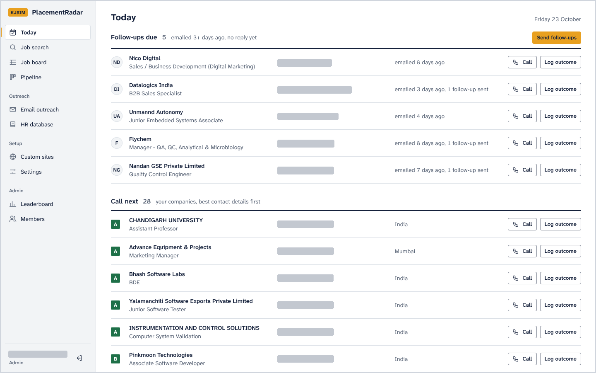

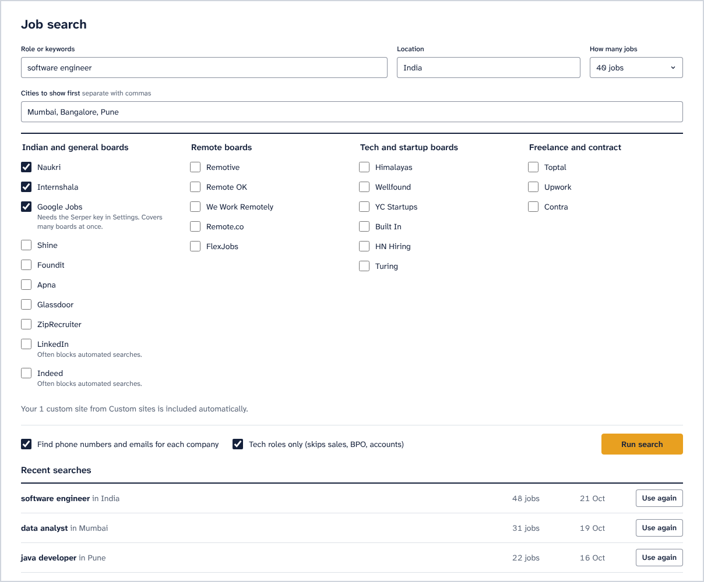

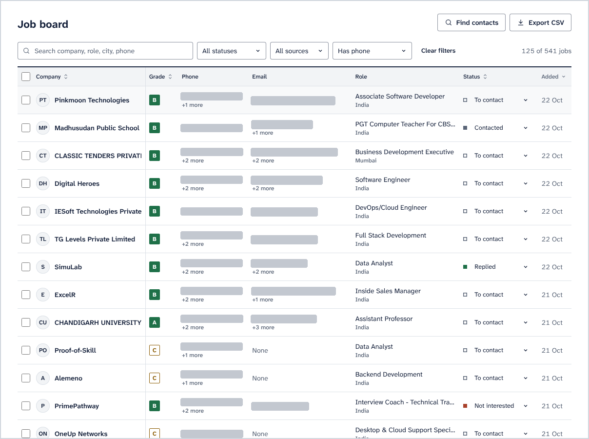

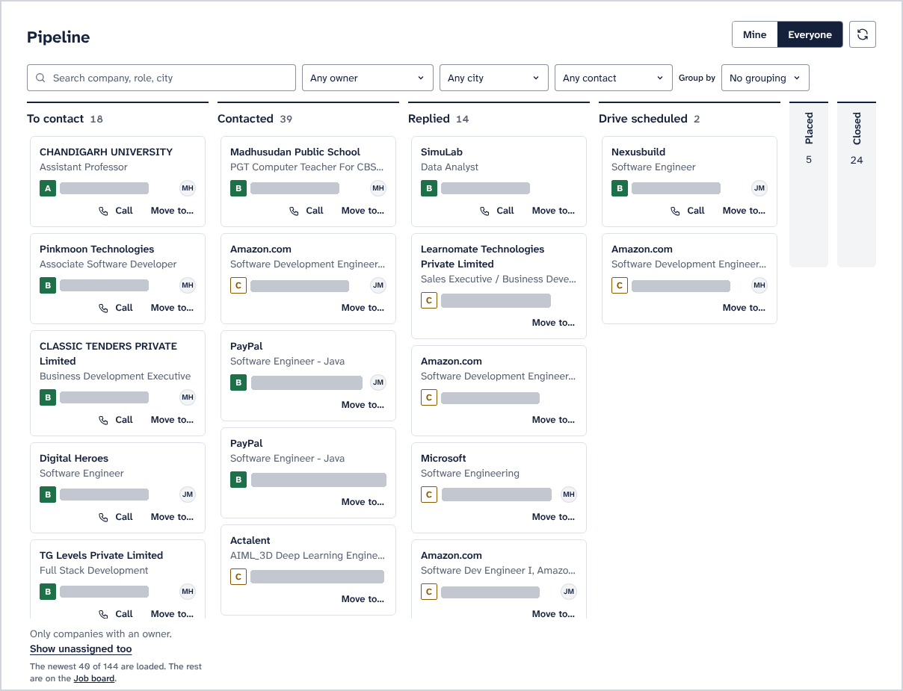

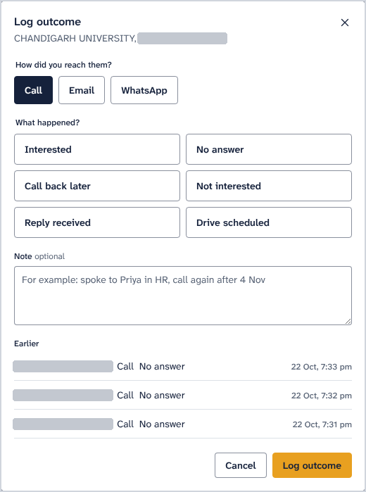

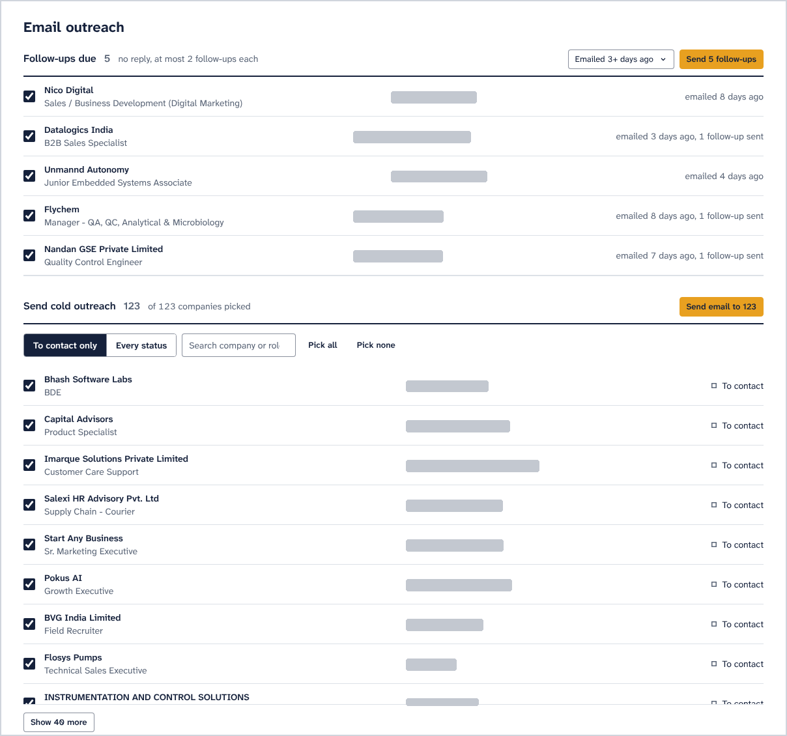

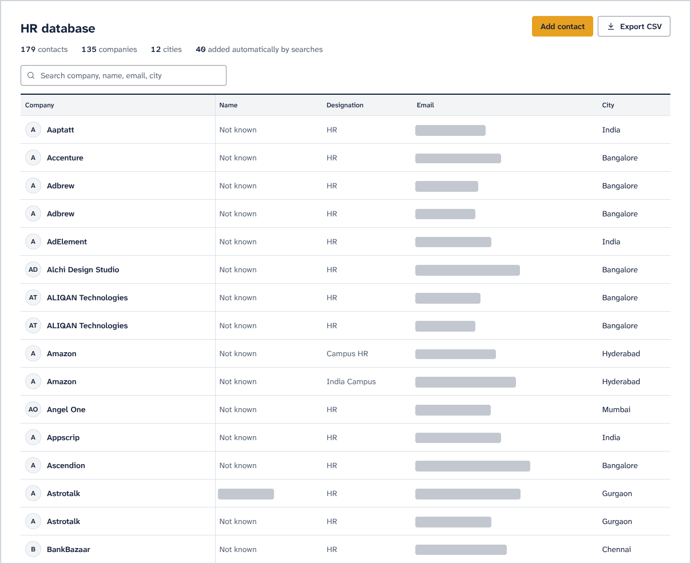

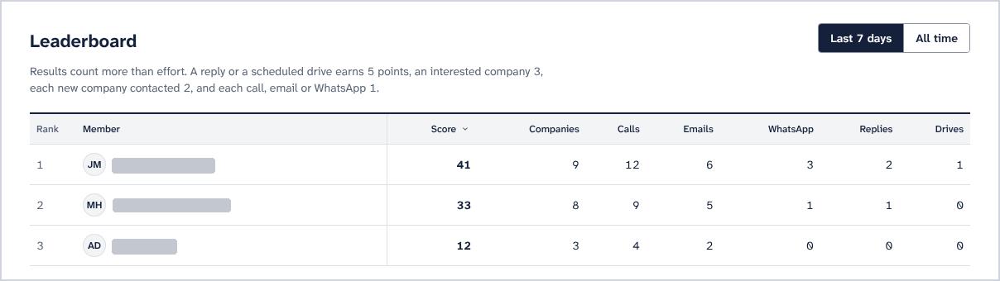

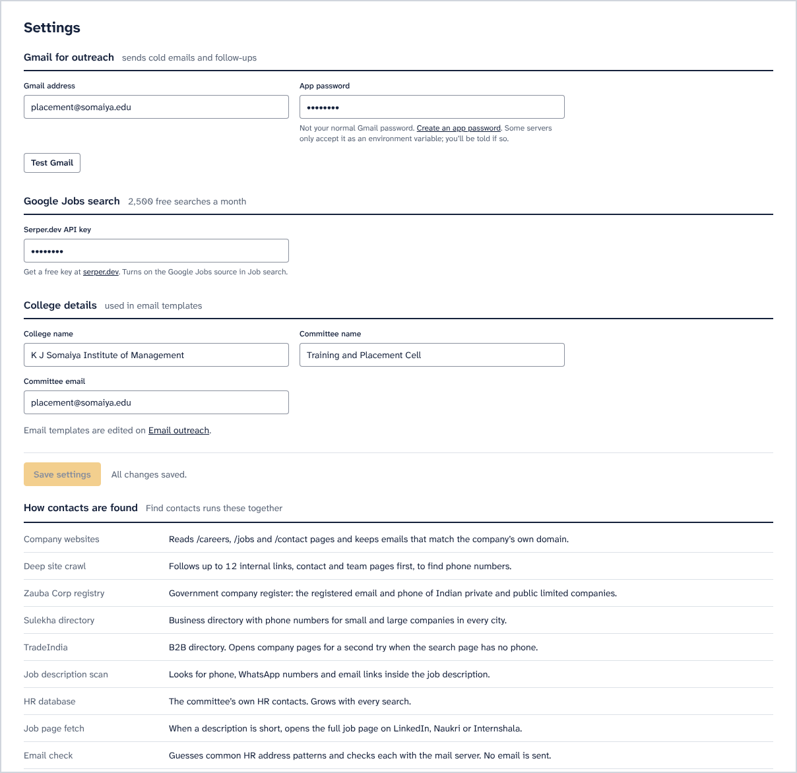

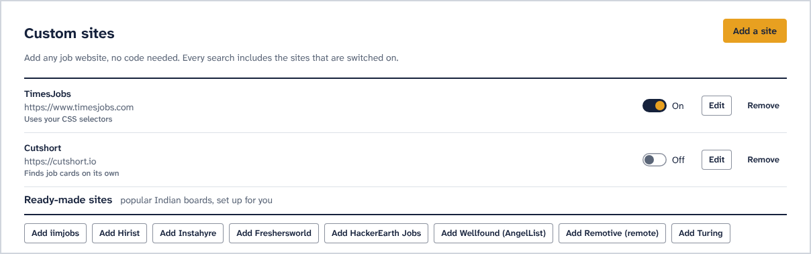

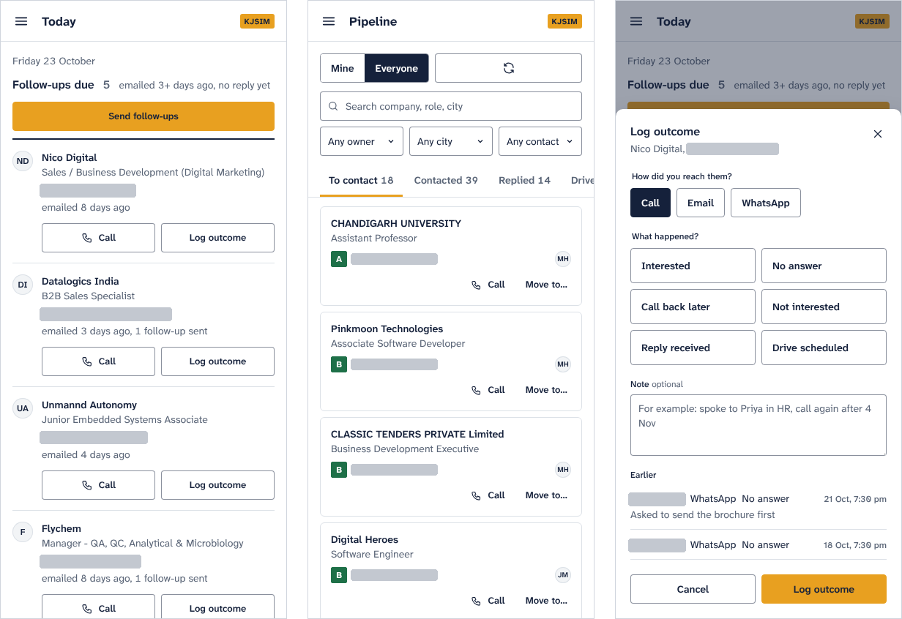

## 6. Results and measurements

The contact store grew more than fourfold over the project, and email deliverability stayed above 97%. All numbers are counts from the project's own data.

### 6.1 Contact store

| Metric | First draft (25 Sep) | Final (25 Oct) |
|---|---|---|
| Companies tracked | 314 | 1,732 |
| Companies with at least one contact | not measured | 1,573 |
| Resolved to a confirmed website | 186 | 186 |
| Total contacts | 501 | 2,324 |
| Emails | 223 | 2,046 |
| Phones | 278 | 278 |
| Emails passing the MX check | 220 (98.7%) | 1,994 (97.5%) |
| Contacts naming a specific person | not measured | 1,823 |
| Contacts ranked usable for outreach | 407 | 2,181 |

The share of companies with a confirmed website fell from 59% to 11%, which is expected. Companies imported from the directory stay keyed by name until a website passes the corroboration gate, and an email that happens to share a domain is not enough to confirm one.

### 6.2 Identity resolution

| Stage | Companies with a usable website |
|---|---|
| Baseline | 21.2% |
| After automated resolution | 53.3% |
| After human review | 61.4% |

### 6.3 Discovery and yield

- The scraper accepted a location but never used it. Before the fix the data held 3 Mumbai companies out of 314; afterwards a single run returned 153.
- In a live search for "software developer, Mumbai", 5 of the first 10 jobs came with a phone number and 4 with an email, all on the company's own domain.
- Sitemap crawling found contacts for 51 of 120 companies (42.5%) that previously had none.
- 125 companies have a confirmed Mumbai office, and 88 HR contacts can be paired with a Mumbai office line.

### 6.4 Office discovery through OpenStreetMap

| City | Offices found | With a phone number |
|---|---|---|
| Bengaluru | 1,881 | 218 |
| Pune | 288 | 59 |
| Mumbai | 285 | 45 |

### 6.5 Source reliability and email-format inference

- A test of all 23 job boards on 26th October 2026 found 4 that returned relevant jobs. Fixing three scrapers raised that to 7: Himalayas had lost every company name, RemoteOK matched only the exact search phrase, and Remotive's API ignores the search. 15 boards still return nothing, including Naukri, which now asks for a captcha. Every board reports to the source-health table, where an empty result counts as a failure.
- The default search used Internshala, Naukri and Google Jobs, so in practice it found jobs on Internshala alone. With Indeed, LinkedIn and Internshala as the defaults, one search for "software engineer, Mumbai" returned 29 tech jobs from 23 companies.
- Routing the directory lookups through the throttle made their status codes visible. Sulekha answers 403 to every request, Zauba and TradeIndia answer 404, and JustDial and IndiaMART answered 200 without a single phone number for four large companies.
- Three planned data sources were dropped after measuring them. ATS APIs covered 1.6% of companies, automatic extraction of recruiter names was 0% precise, and a third-party OSINT tool failed on every source.
- Email-format inference, which guesses addresses in a company's usual style (such as `firstname.lastname@`) the way RocketReach and SignalHire do, predicted the exact address 72% of the time against a 59% baseline.

## 7. Key findings

Every serious defect in this project showed up only when someone read individual records. The totals looked healthy each time.

- Reading records turned up two companies merged under one identity, contacts filed under the wrong employer, and a scraper that returned an unrelated page.
- Pages can return HTTP 200 without answering the query. A directory served an empty soft block, a job board redirected unknown searches to a generic listing, and parked domains answered like company sites. Checking the content was the only way to catch these.
- Validation rules can throw away the most useful data. Mobile-only phone validation rejected every office landline, and an audit of the stored numbers still passed, because rejected numbers leave no trace.
- Common words make unrelated companies look alike. The word "Private", from "Private Limited", was enough to give one company another's HR contacts. Matching now uses only the distinctive words in a name.
- The column treated as a phone number's source held the job board the listing came from, so the origin of 157 numbers was mislabelled.
- A per-domain throttling module was written but nothing called it until the final week. It now spaces out requests to the shared directory sites.
- The search defaults pointed at a blocked board and a paused one, while the two most productive boards were switched off and labelled as unreliable.
- Measuring before building removed three planned sources that would not have worked, and showed that email-format inference was worth building.

## 8. AI implementation

The core decisions use rules that a person can inspect. Before the committee contacts a stranger on the system's advice, a member needs to be able to see why the system thinks the contact is right.

### 8.1 Implemented

- Content-relevance scoring compares the words in the query with the returned jobs, with stemming, and rejects pages that score below 0.20.
- Entity resolution matches companies to websites through a corroboration gate, compares only the distinctive words in names, and rejects evidence that merely repeats the guess.
- Confidence scoring combines own-domain match, MX verification, a named person, an HR role and cross-company spread into a score from 0 to 1.
- Classifiers separate technical from non-technical roles, role accounts from named people, parked domains from real ones, and mobiles from landlines.
- The A to F grade and the five-tier outreach list put the committee's work in order.

### 8.2 Next: learning from labelled data

- A fixed cut-off of 0.6 did not work with the current weights. A stratified sample of 103 contacts is ready for labelling as good, wrong company, dead or unsure, and the threshold will be set from the precision measured at each cut-off.
- Email-format inference would learn each company's address format; the measured exact-match rate is 72%.
- An LLM could help review attribution cases that need outside knowledge, such as a subsidiary's email that still serves its former parent company.
- Embeddings could match roles by meaning, and reply classification could drive follow-ups.

## 9. Social cause

Campus recruitment favours institutes with reach. Well-funded institutes have salaried placement offices and decades of corporate contacts, while most colleges depend on a volunteer committee and a spreadsheet.

With PlacementRadar, a committee that inherited no contact list starts with a ranked list of 2,181 usable contacts. The CRM keeps every company, owner, note and call, so next year's committee inherits the work. Running it costs nothing, so the colleges that need it most can keep using it.

## 10. Limitations and open work

| Item | State |
|---|---|
| Confidence threshold | Waiting on the 103 labels |
| Contact attributions | 43 cases in the review sheet |
| OpenStreetMap offices | Merge would add 333 companies and 334 phone numbers; 11 matches with existing companies await review |
| Phone provenance | Applied; all 157 numbers carry their job-board source |
| Request throttling | Wired into the five directory lookups |
| Job boards | 15 of 23 return no jobs |
| Contact directories | Sulekha blocked; Zauba and TradeIndia search URLs out of date |
| Analytics for the placement head | Not built |
| Deployment | The rebuilt app runs locally; the live site still runs the earlier version |

## 11. Future scope

- The college's alumni list (name, batch, current employer) can be matched to companies through the same identity resolution, so each company shows how many alumni work there. Alumni data would be stored separately, visible only to admins and used only for placement outreach, in line with the Digital Personal Data Protection Act, 2023.
- In the medium term: a student portal with openings matched to each profile, resume-to-role matching, and WhatsApp Business integration.
- In the long term: a deployment shared by several colleges, with an opt-in pool of verified contacts that gets more accurate as more colleges join.

## 12. Technologies used

| Area | Tools |
|---|---|
| Backend | Python 3.13, Flask, PyMongo, BeautifulSoup4 + lxml, Requests, concurrent.futures |
| Data and validation | MongoDB (separate company and auth databases), libphonenumber, email-validator, dnspython, pandas |
| Open data | OpenStreetMap Overpass API, Wikidata API |
| Frontend | React 18 + htm (bundled, no build step), hash router, Atkinson Hyperlegible Next |
| Security | Werkzeug PBKDF2 hashing, signed session cookies, login rate limiting, environment-only secrets, XSS escaping |
| DevOps | Docker, GitHub Actions (CI and a free scraping worker), Render, Gmail SMTP |
| Testing | pytest: 28 tests on canned responses, with no network or database access |

## 13. Conclusion

PlacementRadar set out to automate a placement committee's outreach. It searches 23 job boards, 7 of which returned jobs in the final test, matches each company to its real website, verifies and scores 2,324 contacts, and gives the committee a CRM and a phone-friendly interface that starts each day with a list of who to call.

The totals kept saying the system worked while individual records were wrong. Each fix therefore added a check to the pipeline itself: corroboration gates, relevance guards, quarantine in place of deletion, and review queues wherever the data could not decide.
